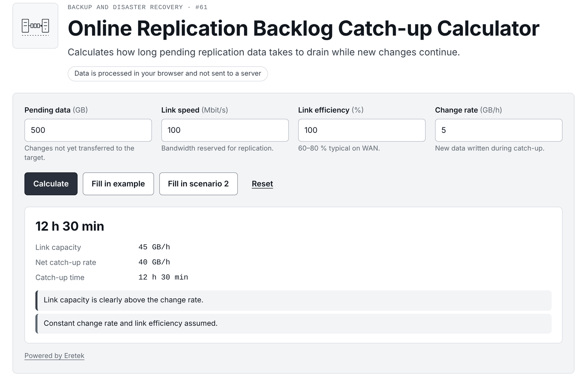

# Replication Backlog Catch-up Calculator

From pending replication data, link speed and efficiency and the new change rate, calculate when the DR site will be current again; warns if the link is too small.

## Try it live

- [Türkçe](https://sistem.eretek.com/araclar/replikasyon-backlog-suresi)
- [English](https://sistem.eretek.com/en/tools/replication-backlog-catch-up)
- [Deutsch](https://sistem.eretek.com/de/werkzeuge/replikation-rueckstand)



## What it does

Calculates how long pending replication data takes to drain while new changes continue.

After a link outage, initial sync or a large data load, replication falls behind. Production keeps writing meanwhile; if link capacity is only slightly above the change rate, the backlog takes days to drain and RPO breaks. The tool gives the net catch-up speed and time.

## Where it helps

If the change rate exceeds 70 % of link capacity the system is prone to falling behind permanently; plan compression, WAN acceleration or a bigger link.

## How to use it

1. Enter the accumulated (pending) data.
2. Enter link speed, efficiency and the average production change rate (GB/hour) during catch-up; press Calculate.

### Fields

| Field | Description |
|---|---|
| Pending data | Changes not yet transferred to the target. |
| Link speed | Bandwidth reserved for replication. |
| Link efficiency | 60–80 % typical on WAN. |
| Change rate | New data written during catch-up. |

## Example input

Press **Fill in example** in the tool to load this input.

| Input | Value |
|---|---|
| Pending data | `500` |
| Link speed | `100` |
| Link efficiency | `100` |
| Change rate | `5` |

**Expected result:** A 100 Mbit/s link carries 45 GB/h; with 5 GB/h of new changes net 40 GB/h, a 500 GB backlog drains in 12 h 30 min.

## Method and assumptions

Link capacity (GB/h) = Mbit/s × efficiency × 10<sup>6</sup> / 8 × 3600 / 10<sup>9</sup>. Net = capacity − change. Time = backlog / net. With net ≤ 0 the backlog never drains.

## Limits and common mistakes

- Intraday change variation, latency impact on TCP and replication software compression are not modelled.

## Run it locally

The tool is plain HTML, CSS and JavaScript with no build step and no dependencies.

```bash
git clone https://github.com/eretek/replication-backlog-catch-up.git
cd replication-backlog-catch-up
node scripts/serve.js        # or: python3 -m http.server 8080
```

Open <http://127.0.0.1:8080/>. Add `?lang=tr` or `?lang=de` for Turkish or German; without it the page follows the browser language and falls back to English. You can also open `index.html` directly from disk.

Run the tests (Node.js 18 or later):

```bash
node test/run.js    # or: npm test
```

The tests run the tool's own fixtures and the worked examples in all three languages without a browser.

## How it works

All processing happens in your browser. The tool makes no network requests, uses no cookies or browser storage, and does not upload files you select.

No server-side component is needed. The version on the Eretek website renders the same page through a private WordPress plugin; that plugin only produces the page markup and is not part of this repository.

| Path | Purpose |
|---|---|
| `index.html` | Page shell |
| `src/app.js` | Builds the page in Turkish, English or German from `src/data.js` |
| `src/data.js` | Field definitions, examples and all texts in three languages |
| `src/core.js` | Shared runtime: validation, number formats, result rendering, CSV/ICS export |
| `src/tool.js` | The calculation or analysis for this tool |
| `docs/screenshot.png` | Screenshot used in this README |
| `src/tools.css`, `src/page.css` | Styles |
| `test/run.js`, `test/cases.json` | Headless tests |

## License and attribution

This tool is released under the [Eretek Website Attribution License](LICENSE). You may use, modify and redistribute it, including commercially. If you make it available on a website or web application, show a visible, clickable credit linking to https://eretek.com/ on every page where the tool is available, for example:

```html
<a href="https://eretek.com/">Powered by Eretek</a>
```

You may add `rel="nofollow"` to the link. Keep the copyright notice and license text in copies and redistributions.
